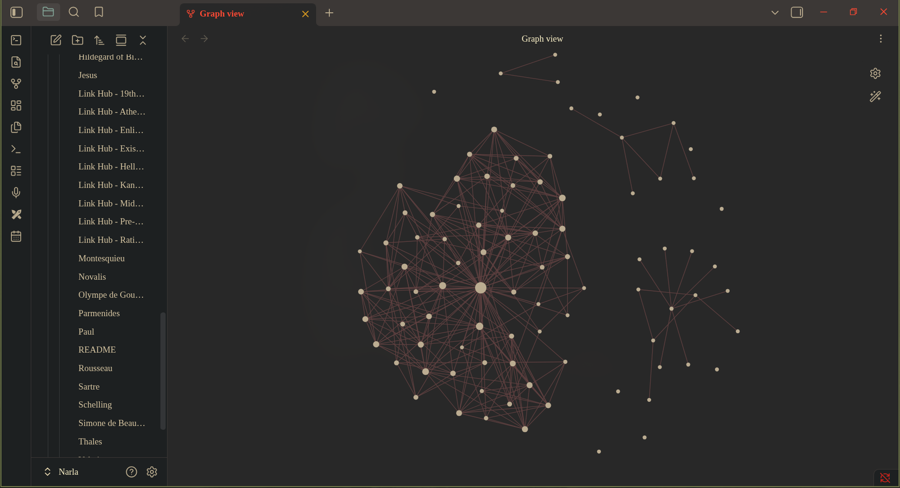

# A Guide to Philosophy — *Sophie's World* Obsidian Vault

**Extreme-detail, chapter-by-chapter summaries of Jostein Gaarder's novel *Sophie's World* — a history of Western philosophy told as a mystery. Story/plot chapters skipped; doctrine kept in full. 59 notes, ~59,000 words, 422 Obsidian `[[wikilinks]]`, 0 broken links, 9 era link hubs, 1 master map.**

> **Built for:** Obsidian · **Vault entry point:** `00 - MASTER Philosophy Map.md` · **Notes:** 59 · **Source:** *Sophie's World* by Jostein Gaarder · **Format:** plain Markdown, no frontmatter, no build step · **Upstream:** `github.com/Narla7/a-guide-to-philosophy-sophies-world` (branch `main`, no releases/tags)

---

## Table of Contents

- [What Is This Vault?](#what-is-this-vault)
- [At a Glance](#at-a-glance)
- [Use in Obsidian (Start Here)](#use-in-obsidian-start-here)
  - [Option A — Clone and open as its own vault](#option-a--clone-and-open-as-its-own-vault)
  - [Option B — Drop it inside an existing vault](#option-b--drop-it-inside-an-existing-vault)
  - [Option C — Read it without Obsidian](#option-c--read-it-without-obsidian)
  - [Navigation — wikilinks, hubs, backlinks, Graph View](#navigation--wikilinks-hubs-backlinks-graph-view)
  - [Why Hellenistic Philosophy Is One File](#why-hellenistic-philosophy-is-one-file)
- [Features](#features)
- [How the Vault Works](#how-the-vault-works)
- [Requirements](#requirements)
- [Installation](#installation)
- [Quick Start](#quick-start)
- [Note Anatomy and Vault Conventions](#note-anatomy-and-vault-conventions)
- [Content Map](#content-map)
  - [0 · Entry Point](#0--entry-point)
  - [1 · Opening Frames — Wonder, Myth, Fate](#1--opening-frames--wonder-myth-fate)
  - [2 · Pre-Socratics (the first Greek natural philosophers)](#2--pre-socratics-the-first-greek-natural-philosophers)
  - [3 · Athenian Classics (5th–4th c. BC)](#3--athenian-classics-5th4th-c-bc)
  - [4 · Hellenism (322 BC – c. AD 400)](#4--hellenism-322-bc--c-ad-400)
  - [5 · Two Cultures and Early Christianity](#5--two-cultures-and-early-christianity)
  - [6 · The Middle Ages (c. 400–1400)](#6--the-middle-ages-c-4001400)
  - [7 · Renaissance, Baroque, and Descartes](#7--renaissance-baroque-and-descartes)
  - [8 · Rationalism and Empiricism](#8--rationalism-and-empiricism)
  - [9 · The Enlightenment](#9--the-enlightenment)
  - [10 · Kant, Romanticism, Hegel](#10--kant-romanticism-hegel)
  - [11 · The 19th-Century Breakers](#11--the-19th-century-breakers)
  - [12 · Our Time — Existentialism and After](#12--our-time--existentialism-and-after)
  - [13 · Finale — Cosmos and the White Rabbit](#13--finale--cosmos-and-the-white-rabbit)
- [Reference — The Nine Link Hubs](#reference--the-nine-link-hubs)
- [Reference — Link Integrity](#reference--link-integrity)
- [Examples](#examples)
- [Troubleshooting](#troubleshooting)
- [FAQ](#faq)
- [Maintenance and Development](#maintenance-and-development)
- [Project Structure](#project-structure)
- [Sources and Faithfulness](#sources-and-faithfulness)
- [Limitations and Legal Notes](#limitations-and-legal-notes)
- [Contributing](#contributing)
- [License](#license)

---

## What Is This Vault?

This repository is a **ready-to-open [Obsidian](https://obsidian.md/) vault of philosophy study notes**. It is not a program, not a Python package, not a site — there is nothing to build and nothing to run. The content is Markdown; Obsidian is the reader.

The notes are dense summaries of the philosophy taught inside Jostein Gaarder's novel *Sophie's World*, where a 14-year-old girl is mailed a course in the history of Western philosophy. Every chapter of philosophy in the book is extracted into a note; every chapter that is only plot (Alberto's visits, the dinner parties, the Oslo trip, the garden party, the mystery of who mailed the letters) is deliberately skipped. What remains is the doctrine, with the book's own worked examples, its own analogies, its own quirks, and its own silences preserved.

**Before:** a stack of `.md` files with no map, no cross-references, and long unreadable filenames.

```
Thales.md   05 - Socrates - Athens and the Art of Questioning.md   (a flat pile)
```

**After:** the same files, wired into a graph you can walk.

```text
00 - MASTER Philosophy Map
      │
      ├─► Link Hub - Athenian Classics ──► Socrates ──► Plato ──► Aristotle
      │                                        │           │          │
      │                                        │           ▼          ▼
      │                                        │     Augustine     Aquinas
      │                                        │     (Plato →)   (Aristotle →)
      │                                        ▼
      └─► Link Hub - Rationalism and Empiricism ──► Descartes ──► Spinoza
                                                             │
                                                             ▼
                                                         [[Graph View]] = 59 notes, 422 edges
```

Two things make this a *vault* rather than a folder of notes:

1. **Filenames are the link targets.** Every cross-reference is an Obsidian `[[wikilink]]` that resolves by filename, so the links are clickable, autocomplete-able, and show up in Obsidian's backlinks pane and Graph View. Verified: **422 wikilinks, 0 broken.**
2. **Hubs give each era a landing page.** The nine `Link Hub - *.md` files hold one-line theses, comparison tables, lineage diagrams, and debate summaries, so you can orient yourself in an era before reading 2,000 words per chapter.

**Live preview — the actual Graph View of this vault (59 notes, 422 edges):**



---

## At a Glance

| Property                                  | Value                                          |
| ----------------------------------------- | ---------------------------------------------- |
| Notes (excluding this README)             | 59                                             |
| Markdown files in repo                    | 60 (59 notes + `README.md`)                    |
| Total words in notes                      | 59,068                                         |
| Total lines in notes                      | 3,997                                          |
| Size of the 59 notes                      | 386 KiB (395,156 bytes)                        |
| Wikilinks across notes                    | 422 — **0 broken**                             |
| — of which alias form `[[stem\|Display]]` | 183                                            |
| — of which plain form `[[stem]]`          | 239                                            |
| Numbered files (`00`–`26`)                | 23 = 1 master map + 22 era chapters            |
| Per-philosopher / per-era files           | 27                                             |
| Era link hubs                             | 9                                              |
| YAML frontmatter                          | 0 — plain Markdown throughout                  |
| Files with a `## Related` section         | 55 of 59                                       |
| Images, attachments, PDFs, tags           | 1 image (Graph View preview below); no attachments/PDFs/tags |
| Fenced code blocks in the notes           | 2 ASCII diagrams, both in hubs                 |
| Tracked in git                            | 62 files (60 `.md` + `.gitignore` + 1 `.png`) |
| Vault config committed?                   | No — `.obsidian/` and `.trash/` are gitignored |

**File classes at a glance**

| Class                  | Pattern                         | Count | Purpose                                   |
| ---------------------- | ------------------------------- | ----- | ----------------------------------------- |
| Master map             | `00 - MASTER Philosophy Map.md` | 1     | Chronological index; the entry point      |
| Era chapter            | `NN - Title - Subtitle.md`      | 22    | One book chapter, doctrine only           |
| Philosopher / era note | `Name.md`                       | 27    | One thinker (or one era) per file         |
| Link hub               | `Link Hub - Era.md`             | 9     | Era landing page, theses, tables, lineage |

---

## Use in Obsidian (Start Here)

> **This repository is designed to be used inside an Obsidian vault.** The links are Obsidian `[[wikilinks]]`, the hub files are Obsidian landing pages, and the cross-referencing is only useful with Obsidian's link resolution, backlinks pane, and Graph View. You can read the files as plain text on GitHub, but you will lose the navigation, the autocomplete, the backlink graph, and the ability to see the web of philosophers as a picture.

### Option A — Clone and open as its own vault

Best if the philosophy notes are their own project. The folder becomes the vault root.

```bash
# 1. Clone
git clone https://github.com/Narla7/a-guide-to-philosophy-sophies-world.git
cd a-guide-to-philosophy-sophies-world

# 2. Confirm the vault is intact before opening it
ls -1 *.md | wc -l          # → 60   (59 notes + README.md)
```

3. In Obsidian: **Open folder as vault** → select `a-guide-to-philosophy-sophies-world`.
4. Obsidian may ask whether to trust/scan the folder. It is plain text; nothing executes.
5. Open **`00 - MASTER Philosophy Map.md`** in the file explorer (it sorts first because it starts with `00 -`). Bookmark it — hover the entry in the left pane and click the ☆/bookmark icon so it lands in the **Bookmarks** view, or just leave it open; Obsidian reopens your last file.

```bash
# Optional sanity checks before you open it
grep -c '\[\[' *.md | head          # wikilink density per note
git log --oneline                   # 1 commit: "Add Sophie's World philosopher summaries as Obsidian vault"
```

`.obsidian/` is listed in `.gitignore`, so a fresh clone has **no committed vault settings** — theme, plugins, hotkeys, and graph filters are yours to set, and none of them will ever be committed back by accident. That is intentional: see [Project Structure](#project-structure).

### Option B — Drop it inside an existing vault

Best if you already keep notes in Obsidian and want the philosophy web next to them.

```bash
# Copy the folder into your vault's notes area, then open your vault as usual
cp -r a-guide-to-philosophy-sophies-world ~/Documents/MyVault/Philosophy/
```

Then, in your vault:

1. Use the **Quick switcher** (`Ctrl/Cmd + O`) and type `MASTER` to jump to `00 - MASTER Philosophy Map.md`.
2. Add the master map to your vault **Homepage/Start page** if you use a homepage plugin — it is the single index for this material.
3. Open **Graph View**, then filter to the folder so the 59 notes stand out from the rest of your vault.

**One thing to check when you merge it into a big vault:** Obsidian resolves a `[[wikilink]]` by filename across the whole vault. If another note in your vault is also called `Thales.md`, `Augustine.md`, or `Sartre.md`, Obsidian will either pick one arbitrarily or show a disambiguation menu. Rename the colliding file, or accept the disambiguation menu. This vault uses long, descriptive filenames (`05 - Socrates - Athens and the Art of Questioning.md`) precisely so that collisions are unlikely.

### Option C — Read it without Obsidian

Plain GitHub browsing works, and `[[wikilinks]]` are still readable as text. On GitHub the note titles are the anchor, so jump straight to the [Content Map](#content-map) below, which lists every filename grouped by era. If you prefer a local editor, any Markdown editor that follows `[[…]]` (Typora, MarkText, Obsidian, Logseq) will render the links.

### Navigation — wikilinks, hubs, backlinks, Graph View

**1. Start at the master map.** `00 - MASTER Philosophy Map.md` is a chronological index: a "Hubs" block, then every note in book order, then a two-line "How to use" section.

```text
00 - MASTER Philosophy Map
  ├── Hubs (9)  ─────────────► every era landing page
  └── Chronology (wonder → the 20th century)
        ├── 01 Wonder  →  02 Myths  →  04 Fate
        ├── Thales … Democritus  (8 Pre-Socratics)
        ├── Socrates → Plato → Aristotle
        ├── 08 Hellenism (one file, all four schools)
        ├── 09 Two Cultures → Jesus → Paul
        ├── Augustine → Hildegard of Bingen → Aquinas
        ├── 11 Renaissance → Baroque → Descartes
        ├── Spinoza → Locke → Hume → Berkeley
        ├── Montesquieu / Voltaire / Rousseau / Olympe de Gouges
        ├── Kant → Romanticism (Novalis, Herder, Schelling, Fichte) → Hegel
        ├── Kierkegaard / Marx / Darwin / Freud
        ├── 25 Existentialism → Sartre / Beauvoir / Camus / Arne Naess
        └── 26 Cosmos and finale
```

**2. Follow wikilinks between thinkers.** In Obsidian, `[[…]]` is clickable and autocompletes as you type. Because most filenames are long, the notes use the alias form so the rendered text stays short:

```markdown
[[05 - Socrates - Athens and the Art of Questioning|Socrates]]
[[13 - Spinoza - One Substance God-Nature and Ethics|Spinoza]]
```

Renders as **Socrates**, jumps to the file. 183 of the 422 links use this alias form; the other 239 are plain `[[Thales]]`-style links, which is what you would expect for the unnumbered one-word filenames.

The chains the vault is built around, all of them one click from any note:

| Chain                      | Route                                                                                            |
| -------------------------- | ------------------------------------------------------------------------------------------------ |
| The Greek triangle         | `Socrates → Plato → Aristotle` (question → Forms → substance)                                    |
| Christian reception        | `Plato → Augustine` and `Aristotle → Aquinas`                                                    |
| The mind–body line         | `Descartes → Spinoza` (two substances → one substance)                                           |
| The knowledge quarrel      | `Descartes / Spinoza` vs `Locke → Hume → Berkeley` → `Kant`                                      |
| The critique ladder        | `Kant → Romanticism → Hegel → Kierkegaard` (and Kierkegaard's red-bottle/blue-bottle correction) |
| The 19th-century unmaskers | `Hegel → Kierkegaard / Marx / Darwin / Freud`                                                    |
| Our own century            | `Kierkegaard / Hegel / Marx → Sartre → Beauvoir / Camus / Naess`                                 |
| Women's voices             | `Olympe de Gouges` (1789) ↔ `Simone de Beauvoir` (1949) ↔ `Hildegard of Bingen` (12th c.)        |
| Matter and cosmos          | `Democritus` (atoms) → `08 Hellenism` (Epicureans) → `Darwin` → `26 Cosmos` → `Arne Naess`       |

**3. Use the Link Hubs to orient before you read.** A hub is a landing page: a table of one-line theses, a lineage diagram, a comparison table, and a "key debate" section. Open one, get the shape of the era in 30 seconds, then dive into the chapter files.

```text
Link Hub - Athenian Classics            Link Hub - Rationalism and Empiricism
  The Triangle (ASCII diagram)            Rationalism vs Empiricism (table)
  Files / Background / Outward links      "The line to Kant"

Link Hub - Pre-Socratics                Link Hub - Middle Ages
  8 rows: philosopher | one-line thesis  Persons / Historical Frame
  Lineage: Milesians → Eleatics →         Faith vs Reason table (Augustine | Aquinas)
           pluralists → atomists          Medieval worldview in one paragraph
```

**4. Read the backlinks pane.** Open any note and the **Backlinks** view (bottom-left pane) lists every note that links *to* it. This is how you discover the connections the author of the note did not spell out. Try it on `Kierkegaard` (20 inbound links) or `Kant` (19) — the backlinks pane *is* the argument of the vault.

**5. Use Graph View for the philosopher web.** `Ctrl/Cmd + G` opens the graph.

- Every note is a node; every wikilink is an edge. This vault renders as a 59-node web, not a list.
- The most-connected nodes are the load-bearing thinkers: `21 - Kierkegaard…` (20 inbound), `18 - Kant…` (19), `07 - Aristotle…` (15), `20 - Hegel…` (14), `25 - Existentialism…` (12).
- Turn off **Orphans** and **Show tags** in the graph settings to reduce noise (there are no tags in this vault, so the tag nodes are empty anyway).
- Switch to **Local graph** (top-right of the graph view) with `05 - Socrates…` open to see just Socrates' immediate neighbourhood: Plato, Aristotle, Thales, and the Athenian hub.
- In a vault with other notes, add a **Filter → Folder** condition for this folder so the 59 nodes are isolated.

**6. Use Outline and Search.**

- **Outline** (right pane) shows the numbered `##` sections of a chapter file — a 10-section Plato or a 12-section Aristotle is a table of contents you can click.
- **Search** across the vault is the fastest way to answer a doctrine question. Terms that land in the right two or three files: `search: privatio` (Augustine + the Middle Ages hub), `search: tabula rasa` (Locke + the Rationalism hub), `search: apeiron` (Anaximander + the Pre-Socratics hub), `search: Second Sex` (de Beauvoir + the Existentialism hub), `search: Sisyphus` (the three files that flag it as *not* expounded). A negative control: `search: dasein` returns nothing in the notes (only this README contains the word), because the vault deliberately does not include Heidegger's doctrine — see [Sources and Faithfulness](#sources-and-faithfulness).

### Why Hellenistic Philosophy Is One File

Every other era is split to one file per thinker. **The Hellenistic schools are deliberately kept in ONE combined file:**

```
08 - Hellenism - Cynics Stoics Epicureans Neoplatonism.md   (1,965 words, 7 sections)
```

with the companion hub stating the rule in a blockquote:

> Kept as ONE combined file by design — no per-school splits.

**Why:** in *Sophie's World* the Hellenistic period is delivered as one continuous chapter that moves from Alexander's successor kingdoms, through religion-philosophy-science fusion, into the Cynics, Stoics, Epicureans, Neoplatonism, and a closing doctrine of mysticism. The schools only make sense against each other — the Stoics' Logos completes Heraclitus, the Epicureans' atoms descend from Democritus, the Neoplatonists' One is Plato returned as mysticism. Splitting them would sever the very comparisons that make the chapter comprehensible and would fragment 1,965 words into four stub files. The chapter is also one continuous narrative in the novel, unlike Socrates/Plato/Aristotle, which the book teaches as three separate lessons.

The vault is consistent about this: `Link Hub - Hellenistic Philosophy.md` exists to route you into that single file, and `08`'s own `## Related` section links outward to its roots — `Democritus` → Epicureans, `Heraclitus` → Stoic Logos, `Plato` → Neoplatonism — and to its Christian meeting points, `Paul` (the Areopagos sermon is addressed to Stoics and Epicureans), `Augustine`, and `Jesus`.

**Where the splits *do* happen** is the opposite case: chapters that cover several people but are dense enough to be worth splitting. Those produced separate files, each carrying a provenance line naming its source section, e.g. `Paul.md`:

```markdown
# Paul
*Split from [[09 - Two Cultures - Indo-Europeans Semites Jesus Paul|09 - Two Cultures]] §6–§7 — full detail preserved. Overview kept in source file.*
```

That pattern produced `Jesus.md`, `Paul.md`, `Sartre.md`, `Simone de Beauvoir.md`, `Camus.md`, and `Arne Naess.md`. The rule of thumb: **split by philosopher when the book gives the philosopher their own lesson; keep chapters whole when the book treats them as one continuous stretch.**

---

## Features

- **Obsidian-first by construction.** 422 `[[wikilinks]]`, zero broken, verified against the actual filenames. Links resolve by stem because all notes are plain `.md` with no frontmatter.
- **Single documented entry point.** `00 - MASTER Philosophy Map.md` indexes all 58 other notes in book order plus all nine hubs.
- **Nine era link hubs** with one-line thesis tables, lineage diagrams, comparison tables (rationalism vs empiricism; Augustine vs Aquinas on faith and reason; the seven-point Enlightenment program), and "key debate" sections.
- **One file per philosopher** for 27 entries — Thales to Arne Næss — with a consistent internal anatomy (thesis, arguments, key terms, significance, quotes, related).
- **Complete era coverage**, from the first Greek natural philosophers (Thales of Miletus, who predicted the solar eclipse of 585 BC) through the Big Bang and the white rabbit.
- **Story chapters skipped, doctrine preserved.** The plot of *Sophie's World* is not summarized. Where a chapter is mostly plot, the note says so in a "Gaps — stated honestly" section instead of padding.
- **Source-faithful, including the book's gaps.** The notes flag when the book *names* a thinker without expounding them (Camus, Heidegger), when a famous quotation is not in the source (`"one is not born a woman"` in Beauvoir), and when the book's own figures are dated (the cosmology numbers are ~1990 textbook values, kept on purpose).
- **Cross-era lineage made explicit.** Hubs and notes link across centuries so influence is one click: Plato → Augustine, Aristotle → Aquinas, Democritus → Epicureans, Heraclitus → Stoics, Hume → Kant, Hegel → Kierkegaard/Marx, Kierkegaard → Sartre.
- **Two readable note templates** (chapter files and thinker files) so any note is predictable once you have seen two.
- **Zero build step, zero dependencies.** No plugin required. Markdown + Obsidian is the whole stack.
- **Vault stays clean in git.** `.obsidian/`, `.trash/`, `*.tmp`, `.DS_Store` are ignored, so your personal theme, plugins, and workspace never land in a commit.

---

## How the Vault Works

```text
                        ┌───────────────────────────────┐
                        │  00 - MASTER Philosophy Map   │  ← open this first
                        │  hubs block + chronology      │
                        └───────────────┬───────────────┘
                                        │ 58 wikilinks
              ┌─────────────────────────┼─────────────────────────┐
              ▼                         ▼                         ▼
   ┌────────────────────┐     ┌────────────────────┐    ┌────────────────────┐
   │ 9 × Link Hub - …   │     │ 22 × NN - Chapter  │    │ 27 × Name.md       │
   │ era landing pages  │     │ era chapter notes  │    │ philosopher notes  │
   │ thesis tables      │     │ numbered sections  │    │ fixed anatomy      │
   │ lineage diagrams   │     │ Thesis/Arguments/  │    │ Core thesis …      │
   │ comparison tables  │     │ Terms/Legacy       │    │ Related            │
   └─────────┬──────────┘     └─────────┬──────────┘    └─────────┬──────────┘
             └──────────────────────────┼──────────────────────────┘
                                        ▼
                        ┌───────────────────────────────┐
                        │  422 wikilinks, 0 broken      │
                        │  → Backlinks pane             │
                        │  → Graph View (59 nodes)      │
                        │  → Quick switcher (Ctrl/Cmd+O)│
                        └───────────────────────────────┘
```

**Reading order is book order.** File numbers `00`–`26` follow the novel's chapter sequence. The numbers are not contiguous — `03`, `10`, `12`, and `17` are absent:

| Missing | What happened |
|---|---|
| `17` | Content exists, but as a hub: `Link Hub - Enlightenment.md` says "*Hub for the French Enlightenment (file 17 split)*". Its four thinkers got individual files. |
| `03`, `10`, `12` | No file, and **the notes never say why** — the numbering is not fully accounted for. Do not read a missing number as a missing topic: the doctrine either side of each gap is continuous in the neighbouring files, so read `02`→`04`, `09`→`11`, and `11`→`13` before concluding anything is absent. |

**Two file templates.** Chapter files and thinker files differ in shape but share a spine (`## Related` at the bottom, a thesis up top, terms and quotes). See [Note Anatomy and Vault Conventions](#note-anatomy-and-vault-conventions).

**Navigation is symmetric.** 55 of 59 notes end with a `## Related` list; the other four use era-specific closing sections instead (`00 - MASTER Philosophy Map` ends with `## How to use`; `Link Hub - Pre-Socratics` with `## Lineage` + `## Key debate`; `Link Hub - Enlightenment` and `Link Hub - Kant Romanticism Hegel` with `## Links` / flow diagram). So from any note you can always go sideways to a neighbour or hub, and from any hub you can always go down into the chapter files.

---

## Requirements

| Tool | Minimum | Why | Check |
|---|---|---|---|
| [Obsidian](https://obsidian.md/) | Current desktop or mobile release | Renders `[[wikilinks]]`, provides backlinks, Graph View, Quick switcher, Outline, Search. Nothing in the vault needs a plugin. | Launch Obsidian; **File → Open folder as vault** is present |
| A Markdown editor | Any | Fallback if you only want to read the text | `nvim --version`, or any editor |
| `git` | Any recent | Only needed to clone/track the vault | `git --version` |
| Disk | ~400 KB for the notes | 59 notes plus this README, no attachments | `du -ch *.md \| tail -1` |

**Not required:** Node, Python, a build tool, a plugin, or a theme. The vault contains no YAML frontmatter, no tags, no Dataview queries, no Canvas files, and no attachments, so nothing can break silently on an Obsidian upgrade.

---

## Installation

### Recommended — clone, then open as a vault

```bash
git clone https://github.com/Narla7/a-guide-to-philosophy-sophies-world.git
cd a-guide-to-philosophy-sophies-world
ls -1 *.md | wc -l        # → 60
```

Open the folder in Obsidian via **File → Open folder as vault**, then open `00 - MASTER Philosophy Map.md`.

### Without installing anything — read on GitHub

Browse <https://github.com/Narla7/a-guide-to-philosophy-sophies-world>. The [Content Map](#content-map) below is a complete, clickable index of all 59 notes, so nothing is unreachable from this README even without the vault. Note that `[[wikilinks]]` appear as raw text on GitHub.

### Merge into an existing vault

```bash
cp -r a-guide-to-philosophy-sophies-world ~/Documents/MyVault/Philosophy/
```

Open your vault, press `Ctrl/Cmd + O`, type `MASTER`, and you are in. Check for filename collisions with your existing notes — see [Option B](#option-b--drop-it-inside-an-existing-vault).

### Keep it in sync

```bash
cd ~/Documents/MyVault/Philosophy/a-guide-to-philosophy-sophies-world
git pull
```

Because `.obsidian/` is gitignored, pulling updates never touches your local workspace, theme, or plugin settings.

---

## Quick Start

**Step 0 — verify the vault before opening it.**

```bash
cd a-guide-to-philosophy-sophies-world

# 59 notes + README
ls -1 *.md | wc -l                                        # → 60

# all 9 hubs present
ls -1 "Link Hub"*.md | wc -l                              # → 9

# no broken wikilinks (compares every target against real filenames)
python3 - <<'PY'
import glob, os, re
stems = {os.path.splitext(f)[0] for f in glob.glob("*.md")}
rx = re.compile(r"\[\[([^\[\]\|#]+?)(?:\|[^\[\]]+?)?\]\]")
bad = [(f, t) for f in glob.glob("*.md") if f != "README.md"
       for t in rx.findall(open(f, encoding="utf-8").read()) if t.strip() not in stems]
print("broken links:", bad or "none")
PY
```

Expected output:

```text
broken links: none
```

**Step 1 — open the folder as a vault in Obsidian** (**File → Open folder as vault**).

**Step 2 — start at `00 - MASTER Philosophy Map.md`.** It is the chronological index; read the top-to-bottom and follow the numbered era files, detouring into a hub whenever you lose the thread.

**Step 3 — read the era hub before the era chapters.** For example, open `Link Hub - Pre-Socratics.md`: an 8-row table of one-line theses, the Milesians → Eleatics → pluralists → atomists lineage, and the one-vs-many / reason-vs-senses / change-vs-permanence debate. Then read `Thales.md` onward. The same pattern holds elsewhere — `Link Hub - Athenian Classics.md` is the ASCII triangle, `Link Hub - Middle Ages.md` is the faith-vs-reason table for Augustine and Aquinas.

**Step 4 — follow wikilinks instead of the file list.** Click **Socrates** in the master map, then in his note click **Plato** in `## Related`, then **Augustine** from Plato's note (Plato christianized). That is the vault's intended rhythm: index → hub → chapter → related chapter.

**Step 5 — turn on the graph.** `Ctrl/Cmd + G`. Toggle to the **local graph** while a note is open to see one thinker's neighbourhood. If you merged the vault (Option B), filter the graph to this folder.

**Step 6 — search for a doctrine when you have a question, not a chapter.** Obsidian search terms that land in the right two or three files: `search: privatio` (Augustine + the Middle Ages hub), `search: tabula rasa` (Locke + the Rationalism hub), `search: apeiron` (Anaximander + the Pre-Socratics hub), `search: Second Sex` (de Beauvoir + the Existentialism hub), `search: Sisyphus` (the three files that flag it as *not* expounded).

---

## Note Anatomy and Vault Conventions

### Template A — numbered era/chapter files (22 chapters, plus the numbered master map)

Numbered `##` sections, each a claim plus its evidence. Thesis / arguments / terms / legacy are bolded run-in labels, not headings.

```markdown
# 07 - Aristotle - Substance Causes Logic Ethics Politics

*Chapter context: Aristotle (384-322 BC), Plato's pupil for ~20 years, refutes
Ideas and founds logic, biology and systematic philosophy.*

## 1. Life, Character, Project
…
## 3. Substance + Form, Potentiality/Actuality
…
**Thesis:** [the claim]
**Arguments / Details:**
- [point]
- [point]
**Terms:** [term]; [term]; [term]
**Legacy:** [what it handed on]

## Related
- [[05 - Socrates - Athens and the Art of Questioning|Socrates]]
- [[06 - Plato - Forms Cave Soul and State|Plato]]
```

### Template B — per-philosopher / per-era files (27 of them)

A short italic context line under the title, then fixed slots. The eight Pre-Socratics use this shape:

```markdown
# Thales
*Pre-Socratic natural philosopher — from Sophie's World, extreme-detail summary.
Chapter context: …*

## Core thesis
## Arguments / reasoning (full detail, all examples from book)
## Key terms
## Significance / legacy
## Quotes
## Related
```

Slot usage across the 27 files: `## Related` in **all 27**; the 8 Pre-Socratics also carry the full fixed set — `## Core thesis` ×8, `## Arguments / reasoning (full detail, all examples from book)` ×8, `## Key terms` ×8, `## Significance / legacy` ×8. Quotes appear as `## Quotes` ×10 or `## Quotes to keep` ×3; the rest of the files use numbered `## 1.`, `## 2.`, … sections instead.

### Template C — split files (6)

When a chapter covered several people, the philosopher gets their own file, the overview stays put, and the split is documented in an italic provenance line so nothing is duplicated silently:

```markdown
# Camus

*Split from [[25 - Existentialism and Our Time - Sartre Freedom and Meaning|25 - Existentialism and Our Time]] §6 —
full detail preserved. Overview kept in source file. Gaps stated honestly.*
```

### Conventions

| Convention | Rule | Example |
|---|---|---|
| Link target | Always the full filename stem, no `.md` | `[[Thales]]`, `[[18 - Kant - Phenomena Duty and Categorical Imperative\|Kant]]` |
| Aliases | Used whenever the stem is long, so rendered text stays readable | 183 of 422 links |
| `## Related` | Present in 55 of 59 notes; the other 4 use era-specific closers | see [How the Vault Works](#how-the-vault-works) |
| Frontmatter | None. No tags, no aliases, no properties | 0 files with `---` |
| Quotes | Book phrasing only, and dated/attributed when the notes flag it | see [Sources and Faithfulness](#sources-and-faithfulness) |
| Gaps | Stated, never filled from outside the book | `## 2. Gaps — stated honestly` in `Camus.md` |
| Hubs | Named `Link Hub - <Era>.md`, hub text says which chapter it absorbed | `Link Hub - Enlightenment.md` → "file 17 split" |

---

## Content Map

All 59 notes, grouped by era in book order. `w` = words. Filenames are exactly as on disk.

### 0 · Entry Point

| File | w | What it holds |
|---|---|---|
| `00 - MASTER Philosophy Map.md` | 393 | Chronological index: 9 hubs, then every note in book order, then `## How to use`. 58 outbound links. |

### 1 · Opening Frames — Wonder, Myth, Fate

| File | w | Chapter context, in the note's own words |
|---|---|---|
| `01 - What is Philosophy - Garden of Eden and Top Hat.md` | 1,527 | Sophie's opening letters ask "Who are you?" and "Where does the world come from?"; the course answers by defining philosophy as wonder and climbing back up the rabbit's fur. |
| `02 - Myths - Mythological World Picture.md` | 1,244 | What a myth is; Thor worked example; Midgard/Asgard/Utgard; "The Lay of Thrym"; from Norse to Greek myths and the first critique; the city-state as condition for philosophy. |
| `04 - Fate - Oracles and Greek Determinism.md` | 975 | Fatalism defined; why oracles persist; Delphi; history from divine vengeance to natural explanation; medicine from punishment of the gods to Hippocrates. |

### 2 · Pre-Socratics (the first Greek natural philosophers)

| File | w | Thesis in one line |
|---|---|---|
| `Thales.md` | 404 | The source of all things is water. |
| `Anaximander.md` | 317 | Our world is one of myriad worlds in the boundless (*apeiron*). |
| `Anaximenes.md` | 337 | The source of all things is air/vapor via condensation and rarefaction. |
| `Parmenides.md` | 366 | Nothing changes; being has always existed; trust reason over the senses. |
| `Heraclitus.md` | 446 | Everything flows; opposites constitute the world under universal *logos*. |
| `Empedocles.md` | 588 | Four everlasting roots joined and separated by love and strife. |
| `Anaxagoras.md` | 419 | Infinite seeds — "something of everything in everything" — ordered by Mind (*nous*). |
| `Democritus.md` | 824 | Everything is eternal, indivisible atoms plus void, moving by necessity. |
| `Link Hub - Pre-Socratics.md` | 341 | 8-row thesis table; **Lineage**: Milesians → Eleatics → pluralists → atomists; **Key debate**: one vs many, reason vs senses, change vs permanence. |

### 3 · Athenian Classics (5th–4th c. BC)

| File | w | Chapter context |
|---|---|---|
| `05 - Socrates - Athens and the Art of Questioning.md` | 1,888 | After the Pre-Socratics philosophy moves to Athens (~450 BC onward); Socrates (470–399 BC) as midwife, ironist, gadfly; trial and death. |
| `06 - Plato - Forms Cave Soul and State.md` | 2,107 | Plato (428–347 BC), Socrates' pupil, founder of the Academy; Ideas, *episteme* vs *doxa*, dual creature and immortal soul, the Cave, the philosophic state. |
| `07 - Aristotle - Substance Causes Logic Ethics Politics.md` | 2,110 | Aristotle (384–322 BC), Plato's pupil ~20 years; refutes the Ideas, founds logic and biology; substance + form, four causes, *scala naturae*, golden mean, man as political animal. |
| `Link Hub - Athenian Classics.md` | 214 | **The Triangle** ASCII diagram (Socrates → Plato → Aristotle); Sophists as foil; outward links to Augustine and Aquinas. |

### 4 · Hellenism (322 BC – c. AD 400)

| File | w | Contents |
|---|---|---|
| `08 - Hellenism - Cynics Stoics Epicureans Neoplatonism.md` | 1,965 | **One combined file by design.** Historical setting Alexander → Rome; religion/philosophy/science fused; the Cynics; the Stoics; the Epicureans; Neoplatonism; mysticism. |
| `Link Hub - Hellenistic Philosophy.md` | 178 | Routes into the single overview file; one line per school; roots (Democritus → Epicureans, Heraclitus → Stoic *logos*, Plato → Neoplatonism) and the Christian meeting points. |

### 5 · Two Cultures and Early Christianity

| File | w | Contents |
|---|---|---|
| `09 - Two Cultures - Indo-Europeans Semites Jesus Paul.md` | 2,309 | Prelude: recycling and a new savior; the Indo-Europeans; the Semites; Israel; Jesus; Paul and the early church; the Creed as synthesis with Hellenism; postscript on the meeting of two cultures. |
| `Jesus.md` | 549 | Split from `09` §5. Messiah, Son of God, Kingdom of God; the reversed Kingdom; practice; grace vs merit vs Greek self-redemption; fate; the Socrates–Passion parallel. |
| `Paul.md` | 752 | Split from `09` §6–§7. Resurrection foundation; mission to congregations; Athens and the Areopagos in full; collision and common ground; Paul as organizer, Old → New Covenant; the need for dogma. |

### 6 · The Middle Ages (c. 400–1400)

| File | w | Contents |
|---|---|---|
| `Augustine.md` | 1,035 | Late Antiquity to the Middle Ages; faith, reason, illumination; creation *ex nihilo* and the Ideas in God's mind; evil as privation; soul, body, Fall, grace, predestination/foreknowledge; *City of God*. |
| `Hildegard of Bingen.md` | 307 | (1098–1179) nun, preacher, physician, botanist; Sophia — Wisdom and the female side of God; the golden tunic with jewels. |
| `Aquinas.md` | 1,108 | (1225–1274) christianizing Aristotle; one truth, two paths; reason's reach; two paths to the moral life and natural law; the scale of being; the book's critical presentation of his view of women. |
| `Link Hub - Middle Ages.md` | 1,039 | Persons; the full historical frame (Alberto's midnight-to-cock-crow clock, fall of Rome, feudal decline, 529, the three streams and the river metaphor); **Faith vs Reason** table for Augustine vs Aquinas; the medieval worldview in one paragraph. |

### 7 · Renaissance, Baroque, and Descartes

| File | w | Contents |
|---|---|---|
| `11 - Renaissance - Humanism Science and Reformation.md` | 2,071 | The Renaissance as Europe's "fifteenth birthday"; three technical preconditions; from God-centered to man-centered; Copernicus → Kepler → Galileo → Newton; the Reformation; Luther and Erasmus; false causes and science. |
| `Baroque - Era Overview.md` | 1,481 | *carpe diem* / *memento mori*; the Thirty Years' War; life as theater and life as dream (Shakespeare, Calderón, Holberg, Chuang-tzu, Petter Dass); the new cosmology and the mechanistic worldview; materialism vs idealism, mechanism, determinism (Hobbes, La Mettrie, Laplace). |
| `Descartes.md` | 1,340 | Excommunication and the lens-grinder; against Descartes — two substances to one (Spinoza's opening); methodic doubt in full steps, dream → zero → *cogito*; God and the outer world; dualism, *res cogitans* / *res extensa*, the pineal gland, man-machine. |

### 8 · Rationalism and Empiricism

| File | w | Contents |
|---|---|---|
| `13 - Spinoza - One Substance God-Nature and Ethics.md` | 1,111 | From two substances to one; substance, attributes, modes; God not a puppeteer — inner cause and determinism; critique of the anthropomorphic God and the Bible; ethics — passions, reason, freedom. |
| `14 - Locke - Empiricism and Political Rights.md` | 885 | *Tabula rasa*, sensation and reflection; primary vs secondary qualities; rationalistic residues (God, ethics, tolerance); the seed of the division of powers. |
| `15 - Hume - Induction Self and Feeling.md` | 1,936 | Cleaning up concepts, returning to experience; impressions vs ideas; heaven and God as cut-and-paste ideas; the bundle theory; causality in full — habit, constant conjunction, the problem of induction; feelings over reason; the is–ought gap. |
| `16 - Berkeley - To Be Is To Be Perceived.md` | 766 | Immaterialism — *esse est percipi*; against Locke on primary qualities and material substance; table-thump, dreams, hypnosis; spirit as cause; time, space, self. |
| `Link Hub - Rationalism and Empiricism.md` | 211 | Rationalists vs empiricists table; **the line to Kant** (Hume wakes Kant from dogmatic slumber). |

### 9 · The Enlightenment

| File | w | Contents |
|---|---|---|
| `Montesquieu.md` | 352 | Division of powers: Locke to Montesquieu; the shared Enlightenment program he belongs to. |
| `Voltaire.md` | 529 | Life anchors (Hume died 1776, two years before Voltaire and Rousseau, both 1778; all three had been to England and knew Locke); an explicit note that the source has no separate satire/*Candide* passage — "do not invent one from outside" — and that the chapter concentrates on the **seven common points** instead. |
| `Rousseau.md` | 378 | Back to nature; education and childhood; the shared seven-point program. |
| `Olympe de Gouges.md` | 397 | Condorcet; women in the 1789 Revolution; Olympe de Gouges (1748–1793); the wider rights context, point 7. |
| `Link Hub - Enlightenment.md` | 392 | "*Hub for the French Enlightenment (file 17 split)*". Links; the **seven-point program** table (opposition to authority, rationalism, movement, optimism, nature, Deism, rights); the 28-volume *Encyclopedia* 1751–1772; quotes to keep. |

### 10 · Kant, Romanticism, Hegel

| File | w | Contents |
|---|---|---|
| `18 - Kant - Phenomena Duty and Categorical Imperative.md` | 2,399 | The Copernican revolution in the mind; phenomena vs noumena, *das Ding an sich*; limits of reason, antinomies, unanswerable questions; ethics in full detail (categorical imperative formulations, the cat vs human ball); aesthetics, teleology, politics; the closing saying. |
| `19 - Romanticism - Feeling Nature and Genius.md` | 1,812 | Genius, art and the inexpressible; longing, night, the dark side; the sociology of Romanticism; organism vs mechanism; history, Herder and the national spirit; Fichte, Schelling's Dark God and romantic irony. |
| `Novalis.md` | 461 | World-dream; the blue flower; the inward path; Sophie; wider Romantic traits. |
| `Herder.md` | 448 | History; the nation-soul; culture and folk collecting; universal vs national Romanticism. |
| `Schelling.md` | 436 | Absolute / world spirit; nature-philosophy formulas; organism vs mechanism; the Dark God. |
| `Fichte.md` | 334 | Ego; unconscious imagination; romantic irony in context. |
| `20 - Hegel - Spirit Dialectic and History.md` | 2,099 | World Spirit re-defined from spooky to human; reason as historical (the river analogy); the goal — Spirit coming to consciousness; the dialectic with full examples; objective spirit — family, civil society, state; the three stages. |
| `Link Hub - Kant Romanticism Hegel.md` | 249 | Links; the Enlightenment → Kant → Romantic reaction → Hegel system flow diagram; quotes. |

### 11 · The 19th-Century Breakers

| File | w | Contents |
|---|---|---|
| `21 - Kierkegaard - Stages Subjectivity and Leap.md` | 2,327 | The red bottle vs the blue bottle; existence and "the truth for me"; truth as subjectivity, faith, passion; social criticism — the public and the crowd; the three stages of life's way in full; a note on scope stating what Gaarder does *not* develop. |
| `22 - Marx - Alienation History and Capital.md` | 2,118 | Hegel's inversion; base and superstructure (the Greek temple model); modes of production and class struggle; labor and alienation; surplus value and exploitation; why capitalism is self-destructive; dictatorship of proletariat; Gaarder's evaluation and his split of socialism; a Rawls justice coda. |
| `23 - Darwin - Variation Struggle and Selection.md` | 3,730 | **Largest note in the vault.** Shrewsbury to Beagle; *Origin*; fossils, Lyell, geography, embryos; Lamarck rejected and artificial selection; reception and *Descent of Man*; the heredity gap → neo-Darwinism and mutations; modern textbook examples; tree of life and the hot little pool; origins of life; meaning — the eye, Faust, the living planet. |
| `24 - Freud - Unconscious Dreams and Repression.md` | 2,053 | Id–ego–superego; the topographic model; defense mechanisms in everyday life; free association; dreams as the royal road, manifest vs latent, dream-work; Freud and art; a critique of what the book does and does not say. |
| `Link Hub - 19th Century Breakers.md` | 215 | Four unmaskers — existence, history, nature, psyche; the common thread; backlinks to Hegel and Kant; forward links to Sartre. |

### 12 · Our Time — Existentialism and After

| File | w | Contents |
|---|---|---|
| `25 - Existentialism and Our Time - Sartre Freedom and Meaning.md` | 1,926 | The map of our century (Nietzsche and Heidegger named, not expounded); Sartre: existence precedes essence, condemned to be free, bad faith, the absent Pierre; Beauvoir; absurdism and the theater of the absurd; other 20th-century currents listed; ecophilosophy, the New Age market, the white crow, planetary civilization; and §9 stating that the assigned final range is almost entirely story. |
| `Sartre.md` | 830 | Split from `25` §2–§4. |
| `Simone de Beauvoir.md` | 231 | Split from `25` §5. *The Second Sex* (1949); transcending vs immanent; a faithfulness note that "one is not born a woman" is **not verbatim in the extraction**. |
| `Camus.md` | 288 | Split from `25` §6. Absurdism and the theater of the absurd as covered; **§2 Gaps — stated honestly**: Camus's own absurd/Sisyphus/suicide question is not expounded; "do not import" Sisyphus or *The Stranger*. |
| `Arne Naess.md` | 177 | Split from `25` §8. Ecosophy; the top-of-evolution critique; the paradigm shift as remedy. |
| `Link Hub - Existentialism and Our Time.md` | 389 | Core splits (the four files above); precursors and dialogue partners; a currents table (Neo-Thomism, analytical philosophy, Neo-Marxism, materialism, New Age, planetary civilization) flagged as listed, not developed. |

### 13 · Finale — Cosmos and the White Rabbit

| File | w | Contents |
|---|---|---|
| `26 - Cosmos and Finale - Big Bang and the White Rabbit.md` | 955 | Scale: light-minute = 18 million km, light-year ≈ 10 trillion km, the sun 8 light-minutes away, Andromeda 2 million ly; looking out is looking back; expansion and the Big Bang, expand-vs-implosion; linear vs cyclic readings; stardust and the stone; a note keeping the figures at their ~1990 textbook values. |

---

## Reference — The Nine Link Hubs

| Hub | w | Inbound links | Structure |
|---|---|---|---|
| `Link Hub - Pre-Socratics.md` | 341 | 4 | Table: Philosopher \| One-line thesis (8 rows); `## Lineage`; `## Key debate` |
| `Link Hub - Athenian Classics.md` | 214 | 2 | `## The Triangle` (ASCII diagram); `## Files`; `## Background`; `## Outward links` |
| `Link Hub - Hellenistic Philosophy.md` | 178 | 2 | "Kept as ONE combined file by design"; overview; the four schools; roots and meeting points |
| `Link Hub - Middle Ages.md` | 1,039 | 3 | `## 1. Persons`; `## 2. Historical Frame` (sub-sections 2.1–2.6); `## 3. Faith vs. Reason Table`; `## 4. Medieval Worldview in One Paragraph` |
| `Link Hub - Rationalism and Empiricism.md` | 211 | 1 | `## Files`; `## Rationalism vs Empiricism` table; `## The line to Kant` |
| `Link Hub - Enlightenment.md` | 392 | 7 | "*file 17 split*"; `## Links`; `## The seven-point program` table; `## Encyclopedia note`; `## Quotes to keep` |
| `Link Hub - Kant Romanticism Hegel.md` | 249 | 8 | `## Links`; `## Flow diagram (text)`; `## Quotes` |
| `Link Hub - 19th Century Breakers.md` | 215 | 1 | `## Files`; `## Common thread`; `## Backlinks` |
| `Link Hub - Existentialism and Our Time.md` | 389 | 5 | `## Core splits`; `## Precursors / dialogue partners`; `## Currents table` |

Two hubs have only one inbound link (from the master map): `Link Hub - 19th Century Breakers.md` and `Link Hub - Rationalism and Empiricism.md`. They are reachable from the map and from each other (`19th Century Breakers` links to `Kant Romanticism Hegel`), but if you are browsing the file explorer rather than the map, remember they exist.

---

## Reference — Link Integrity

Verified against the actual filenames on disk. Counts cover the 59 notes; this README is excluded (it links out too, which would otherwise inflate the numbers below).

| Metric | Value |
|---|---|
| Total `[[wikilinks]]` in the 59 notes | 422 |
| Broken (target matches no file stem) | **0** |
| Duplicate filenames | 0 — all 59 stems unique |
| Alias form `[[stem\|Display]]` | 183 |
| Plain form `[[stem]]` | 239 |
| Links out of the master map | 58 |
| Notes with ≥1 inbound link | 58 of 59 |
| Inbound link, `00 - MASTER Philosophy Map` | 0 — it is the entry point; nothing needs to link *to* the index |

**Most-linked notes** (highest inbound degree — these are the vault's load-bearing thinkers):

| Inbound | Note |
|---|---|
| 20 | `21 - Kierkegaard - Stages Subjectivity and Leap.md` |
| 19 | `18 - Kant - Phenomena Duty and Categorical Imperative.md` |
| 15 | `07 - Aristotle - Substance Causes Logic Ethics Politics.md` |
| 14 | `20 - Hegel - Spirit Dialectic and History.md` |
| 13 | `Thales.md` · `Democritus.md` |
| 12 | `25 - Existentialism and Our Time - Sartre Freedom and Meaning.md` |
| 11 | `Parmenides.md` · `Schelling.md` · `Sartre.md` |
| 10 | `Heraclitus.md` · `06 - Plato…` · `08 - Hellenism…` · `19 - Romanticism…` · `22 - Marx…` · `23 - Darwin…` |

Kierkegaard and Kant topping this list is a real signal about the book's shape: they are the two figures the later notes keep returning to as a foil. In Obsidian, open either note and the **Backlinks** pane lists everyone arguing with them.

---

## Examples

### The classic — read the Greek triangle in one sitting

1. `00 - MASTER Philosophy Map.md` → click the "Athenian classics" line.
2. Land in `05 - Socrates - Athens and the Art of Questioning.md`. Read `## 3. Who Was Socrates? The Enigma`, then `## 4. The Art of Discourse: Midwife, Irony, Gadfly`.
3. At the bottom, `## Related` → **Plato**.
4. In `06 - Plato…`, read `## 6. Myth of the Cave — Full Detail`.
5. `## Related` → **Socrates** (back up the chain) and **Augustine** (forward, to Christian reception).

### The lineage — trace one idea across 2,000 years

Heraclitus's *logos* → Stoics:

```text
Heraclitus (flux + logos)  →  08 - Hellenism §4 The Stoics  →  13 - Spinoza
   "everything flows"           "logos determinism, duty,        "Deus sive Natura",
   opposites constitute          apatheia; Heraclitean fire       geometrica moralia"
   the world                      become world-reason"
```

Click `Heraclitus` from `Link Hub - Pre-Socratics.md`, open `08 - Hellenism…` from his `## Related`, then `13 - Spinoza…` from there.

### Unicode, long filenames, and aliases

Filenames contain no accents, but the note text does, and aliases keep the display clean:

| Written in the note | Renders as |
|---|---|
| `[[18 - Kant - Phenomena Duty and Categorical Imperative\|Kant]]` | Kant |
| `[[21 - Kierkegaard - Stages Subjectivity and Leap\|Kierkegaard]]` | Kierkegaard |
| `[[13 - Spinoza - One Substance God-Nature and Ethics\|Spinoza]]` | Spinoza |
| `[[11 - Renaissance - Humanism Science and Reformation\|Renaissance]]` | Renaissance |
| `[[Arne Naess]]` | Arne Næss — the filename is ASCII, but `Arne Naess.md` and `25 - Existentialism…` both spell the name **Arne Næss** in the body, so the two transliterations coexist |

### Expert — drive the vault with the Quick switcher

Obsidian's quick switcher matches on filename fragments anywhere in the name, so prefixes are enough:

```text
Ctrl/Cmd + O  then type:

  MASTER          →  00 - MASTER Philosophy Map
  Kierkegaard     →  21 - Kierkegaard - Stages Subjectivity and Leap
  Stoic           →  08 - Hellenism - Cynics Stoics Epicureans Neoplatonism
  Middle          →  Link Hub - Middle Ages
  08              →  08 - Hellenism - …      (numbered files are easy to summon by number)
```

A fragment that is *not* in any filename still works for full-text search but not for the switcher — e.g. typing `Hobbes` in the switcher finds nothing, because Hobbes is discussed inside `Baroque - Era Overview.md` and `14 - Locke…` rather than having his own note. Use **Search** for figures the vault mentions but does not give a file.

### Expert — grep the vault from a terminal

```bash
# Which notes mention privation of good?  (Augustine; this README matches too,
# since it is itself part of the vault when you clone it)
rg -l "privatio" -g '*.md'

# Every note that links to Kierkegaard, with the alias each one uses
rg -o "\[\[21 - Kierkegaard[^\]|]*(\|[^\]]*)?\]\]" -g '*.md' -g '!README.md' | sort | uniq -c

# The five notes with the most inbound links (the hubs of the web).
# Exclude README.md, or this file's own links inflate the counts.
rg -o '\[\[([^]|]+)' -g '*.md' -g '!README.md' -r '$1' --no-filename \
  | sort | uniq -c | sort -rn | head -5
```

```text
     20 21 - Kierkegaard - Stages Subjectivity and Leap
     19 18 - Kant - Phenomena Duty and Categorical Imperative
     15 07 - Aristotle - Substance Causes Logic Ethics Politics
     14 20 - Hegel - Spirit Dialectic and History
     13 Thales
```

### Debug — prove there are no broken links yourself

```bash
python3 - <<'PY'
import glob, os, re
stems = {os.path.splitext(f)[0] for f in glob.glob("*.md")}
rx = re.compile(r"\[\[([^\[\]\|#]+?)(?:\|[^\[\]]+?)?\]\]")
n = bad = 0
for f in glob.glob("*.md"):
    if f == "README.md": continue
    for t in rx.findall(open(f, encoding="utf-8").read()):
        n += 1
        if t.strip() not in stems:
            bad += 1; print("BROKEN", f, "->", t)
print(f"{n} links, {bad} broken")
PY
```

```text
422 links, 0 broken
```

### Debug — inspect a note's structure without opening it

```bash
# Outline of a chapter file = what the Outline pane will show
rg '^#{1,3} ' "06 - Plato - Forms Cave Soul and State.md"

# Word count per note, biggest first (the size distribution of the vault)
wc -w *.md | sort -rn | head -5
```

```text
 3730 23 - Darwin - Variation Struggle and Selection.md
 2399 18 - Kant - Phenomena Duty and Categorical Imperative.md
 2327 21 - Kierkegaard - Stages Subjectivity and Leap.md
 2309 09 - Two Cultures - Indo-Europeans Semites Jesus Paul.md
```

---

## Troubleshooting

| Symptom | Likely cause | Fix |
|---|---|---|
| Wikilinks render as literal `[[…]]` text | Reading in GitHub's web viewer, or an editor without wikilink support | Open the folder in Obsidian (**File → Open folder as vault**), or treat `[[x]]` as a filename `x.md` |
| Clicking a link does nothing / shows "unresolved" | A note was renamed or deleted; the target no longer exists | Run the broken-link check from [Debug](#debug--prove-there-are-no-broken-links-yourself). Currently 0 broken, so any failure means you edited a filename — keep the stem, or fix the inbound links |
| A link opens the *wrong* note | Filename collision: another note in the vault has the same stem (only possible after merging into a larger vault) | Rename one of the two files. `Thales`, `Augustine`, `Sartre` are the likely clash candidates |
| Graph View is a hairball / unreadable | 59 notes plus your other vault notes, orphans and empty tag nodes on | Turn off **Orphans** and **Show tags**; add **Filter → Folder** for this folder; use the **local graph** with one note open |
| `Ctrl/Cmd + G` does nothing | Graph View core plugin disabled | **Settings → Core plugins → Graph view** |
| No autocomplete when typing `[[` | Editor is not Obsidian, or the core *Link* autocomplete option is off | Obsidian: **Settings → Editor → Autocomplete → "Wiki links"** |
| Files are hidden / dotfiles appear | Your viewer shows dotfiles, or `.trash/` from a deletion is visible | `.obsidian/` and `.trash/` are gitignored; they will never arrive from a clone and will not be committed |
| I edited something and do not want it committed | Vault is inside your notes git repo | Commit deliberately: `git status` inside the vault folder, stage only the note you meant to change. `.obsidian/` is already ignored |
| `git pull` says "diverging branches" | You committed locally on top of upstream | `git fetch origin && git diff origin/main --stat` to see what differs, then decide: rebase your work, or reset to upstream if your commits were only local experiments |
| A note I expected is missing (03, 10, 12) | Those numbers were never used; the book's doctrine for those spans is in the neighbouring numbered files | Read `02`→`04`, `09`→`11`, and `11`→`13`; see the [gap table](#how-the-vault-works) |
| A famous idea is in the book but not in the notes (Heidegger, Sisyphus, "one is not born a woman") | The notes are source-faithful: they record what the book covers, and flag what it does not | Read the "Gaps — stated honestly" / faithfulness sections; see [Sources and Faithfulness](#sources-and-faithfulness) |
| Cosmology numbers look outdated (15 billion years, Pluto as outermost planet) | Intentional — the notes keep the ~1990 textbook figures the book uses | `26 - Cosmos…` says so in-line: "keep faithful, do not update to 13.8B/200B+" |
| My terminal/editor is mangling `[[…\|Alias]]` inside tables | A missing escape of the pipe inside a markdown table cell | Use `[[stem\|Alias]]` inside table cells; the vault does this in every table |

---

## FAQ

**Do I need Obsidian, or will a text editor do?**
A text editor works for reading — the files are plain Markdown. Obsidian is what makes the vault a vault: clickable `[[wikilinks]]`, autocomplete, the Backlinks pane, Graph View, the Outline pane, and the Quick switcher. The files are the product; Obsidian is the recommended way to navigate them.

**Why is the master map not linked from any note?**
It is the entry point, so nothing needs to point back at it. In practice, bookmark it (hover the file in the explorer, click the ☆) or leave it open in a tab. It has the highest out-degree in the vault at 58 links.

**Why do so many filenames contain a number and a subtitle?**
The numbers follow the book's chapter order, so the file list sorts into a chronology in Obsidian's file explorer. The subtitles are there to be readable: `05 - Socrates - Athens and the Art of Questioning.md` tells you the chapter's subject before you open it, and it makes filename collisions in a larger vault unlikely. The short form is preserved in links via the alias syntax.

**Why are there no tags, no frontmatter, and no properties?**
Because the vault does not need them. With no frontmatter, a `[[wikilink]]` resolves unambiguously by filename stem, and the link check is a plain set-membership test — which is how "0 broken links" can be stated as a fact rather than a hope. If you add tags for your own vault, they are yours; the vault will not conflict with them.

**Is this a complete history of philosophy?**
No, and it does not claim to be. It is a complete summary of the philosophy taught in *Sophie's World* — a book that is deliberately a first introduction, with its own silences. Nietzsche and Heidegger are named; Nietzsche gets a paragraph, Heidegger a clause. Camus is a name in a list. There is no Aristotle-of-Arabia, no Al-Kindi or Averroes, no Maimonides, no Chinese philosophy, no Indian philosophy beyond the cyclic-time coda, no analytic philosophy, no Simone Weil, no Wittgenstein, no Hannah Arendt, no contemporary philosopher at all. It is a *Sophie's World* vault.

**Why is Hellenism one file when everything else is split?**
Because the book teaches it as one continuous chapter, and the schools only make sense in comparison with each other. [Full explanation](#why-hellenistic-philosophy-is-one-file).

**Can I reformat the notes (headings, bullets, callouts)?**
Yes — nothing in the vault depends on formatting. Two things to preserve: (1) keep `[[stem]]` targets pointing at real filename stems, or the vault's link guarantee is gone; (2) keep the `## Related` closers, because they are the reason you can always walk sideways out of a note.

**What is the "split" convention, in one sentence?**
When the book gives a philosopher their own lesson inside a larger chapter, that philosopher gets their own file; the overview stays in the chapter file, and the new file opens with an italic line naming the source chapter and section it came from — e.g. `*Split from [[25 - Existentialism and Our Time - Sartre Freedom and Meaning|25 - Existentialism and Our Time]] §6*`. Six notes use it: `Jesus`, `Paul`, `Sartre`, `Simone de Beauvoir`, `Camus`, `Arne Naess`.

**Does the vault work offline?**
Yes. It is 60 text files, ~300 KB, no remote assets, no fonts, no images. Once cloned it never needs the network again.

**Can I use these notes in Zettelkasten, Logseq, or Roam?**
The files are plain Markdown with `[[wikilinks]]`, which is the lingua franca of personal knowledge tools. The one thing you lose by flattening the folder structure is the curated chronology in the master map and the nine hubs, which exist to give the material a shape that a flat import will not.

---

## Maintenance and Development

There is no build, test suite, or CI. "Development" here means keeping the link graph intact and the content honest.

```bash
# 1. Status
git status

# 2. What changed
git diff --stat

# 3. Link integrity — must print 0 broken before every commit
python3 - <<'PY'
import glob, os, re
stems = {os.path.splitext(f)[0] for f in glob.glob("*.md")}
rx = re.compile(r"\[\[([^\[\]\|#]+?)(?:\|[^\[\]]+?)?\]\]")
bad = [(f, t) for f in glob.glob("*.md") if f != "README.md"
       for t in rx.findall(open(f, encoding="utf-8").read()) if t.strip() not in stems]
print("broken links:", bad or "none")
PY

# 4. Commit style used in this repo: one descriptive imperative line
#    e188fb1  Add Sophie's World philosopher summaries as Obsidian vault
git add "25 - Existentialism and Our Time - Sartre Freedom and Meaning.md"
git commit -m "Split §8 ecophilosophy into Arne Naess note"
git push
```

**Rules for changing the vault**

| Rule | Reason |
|---|---|
| Never rename a file without fixing every inbound `[[…]]` | The vault's only hard guarantee is 0 broken links |
| Never add YAML frontmatter to a note | Frontmatter `aliases` can shadow a stem and make link resolution ambiguous |
| Add new links with the alias form when the stem is long | Consistency with 183 existing links; keeps rendered text readable |
| Add a `## Related` list to any new note | It is how a reader escapes sideways; 55 of 59 notes do it |
| State gaps rather than filling them from outside the book | The vault's value is that "Gaarder says this" and "Gaarder does not say this" are distinguishable |
| Leave `.obsidian/` out of every commit | It is gitignored on purpose; the vault config is personal |

**When adding a philosopher:** create `Name.md` with Template B (context line, Core thesis, Arguments, Key terms, Significance, Quotes, Related); add the note to `00 - MASTER Philosophy Map.md` in the right chronology slot; add it as a row or bullet in the relevant `Link Hub`; and add inbound `[[Name]]` links from at least the two adjacent notes. Then re-run the link check.

---

## Project Structure

```text
a-guide-to-philosophy-sophies-world/
├── .gitignore                      # .obsidian/ .trash/ *.tmp .DS_Store — vault config stays local
├── README.md                       # this file
│
│   # ── ENTRY POINT ─────────────────────────────────────────────
├── 00 - MASTER Philosophy Map.md   # 58 outbound links; the whole vault in one page
│
│   # ── NUMBERED ERA CHAPTERS (22) ──────────────────────────────
├── 01 - What is Philosophy - Garden of Eden and Top Hat.md
├── 02 - Myths - Mythological World Picture.md
├── 04 - Fate - Oracles and Greek Determinism.md                 # 03 unused
├── 05 - Socrates - Athens and the Art of Questioning.md
├── 06 - Plato - Forms Cave Soul and State.md
├── 07 - Aristotle - Substance Causes Logic Ethics Politics.md
├── 08 - Hellenism - Cynics Stoics Epicureans Neoplatonism.md     # ONE file, by design
├── 09 - Two Cultures - Indo-Europeans Semites Jesus Paul.md
├── 11 - Renaissance - Humanism Science and Reformation.md        # 10 unused
├── 13 - Spinoza - One Substance God-Nature and Ethics.md         # 12 unused
├── 14 - Locke - Empiricism and Political Rights.md
├── 15 - Hume - Induction Self and Feeling.md
├── 16 - Berkeley - To Be Is To Be Perceived.md                   # 17 → Link Hub - Enlightenment
├── 18 - Kant - Phenomena Duty and Categorical Imperative.md
├── 19 - Romanticism - Feeling Nature and Genius.md
├── 20 - Hegel - Spirit Dialectic and History.md
├── 21 - Kierkegaard - Stages Subjectivity and Leap.md
├── 22 - Marx - Alienation History and Capital.md
├── 23 - Darwin - Variation Struggle and Selection.md             # largest note, 3,730 w
├── 24 - Freud - Unconscious Dreams and Repression.md
├── 25 - Existentialism and Our Time - Sartre Freedom and Meaning.md
├── 26 - Cosmos and Finale - Big Bang and the White Rabbit.md
│
│   # ── PER-PHILOSOPHER / PER-ERA NOTES (27) ─────────────────────
│   # Pre-Socratics (8)
├── Thales.md          ├── Parmenides.md     ├── Empedocles.md    ├── Democritus.md
├── Anaximander.md     ├── Heraclitus.md     ├── Anaxagoras.md
├── Anaximenes.md
│   # Middle Ages (3)
├── Augustine.md       ├── Hildegard of Bingen.md                  ├── Aquinas.md
│   # Renaissance / Baroque (1 + 1)
├── Baroque - Era Overview.md                                          ├── Descartes.md
│   # Enlightenment (4)
├── Montesquieu.md     ├── Voltaire.md       ├── Rousseau.md      ├── Olympe de Gouges.md
│   # Romanticism (4)
├── Novalis.md         ├── Herder.md         ├── Schelling.md     ├── Fichte.md
│   # Two Cultures (2) · splits from 09 §5–§7
├── Jesus.md           ├── Paul.md
│   # Our time (4) — splits from 25 §2–§8
├── Sartre.md          ├── Simone de Beauvoir.md   ├── Camus.md     ├── Arne Naess.md
│
│   # ── ERA LINK HUBS (9) ────────────────────────────────────────
├── Link Hub - Pre-Socratics.md
├── Link Hub - Athenian Classics.md
├── Link Hub - Hellenistic Philosophy.md
├── Link Hub - Middle Ages.md
├── Link Hub - Rationalism and Empiricism.md
├── Link Hub - Enlightenment.md              # absorbs "file 17"
├── Link Hub - Kant Romanticism Hegel.md
├── Link Hub - 19th Century Breakers.md
└── Link Hub - Existentialism and Our Time.md
```

**File counts:** 1 master map + 22 numbered chapters + 27 per-philosopher/era notes + 9 hubs = **59 notes**, plus `README.md` = 60 Markdown files. `17` is absorbed into `Link Hub - Enlightenment.md`; `03`, `10`, and `12` are unused.

---

## Sources and Faithfulness

**Primary source**

- **Jostein Gaarder, *Sophie's World*** — a novel in which Sophie Amundsen is mailed a philosophy course by an unnamed teacher and works backwards through the history of Western philosophy to discover who is teaching her. Every doctrine note in this vault is a summary of *that book's* presentation, not of the primary philosophical texts. The notes themselves date their own cosmology to "~1990 textbook" values, so the book they track is a late-20th-century edition.

The vault does not record an edition, translator, or printing. The doctrine notes are written to track a specific English rendering of the book; if you read a different translation, line-level wording may differ, but the doctrine and structure will not.

**What "faithful to the source" means here**

| Practice | Where it shows up |
|---|---|
| Book's own examples kept, even when a philosopher's own texts are richer | The Martian and the flying father in `01`; the cat and the human ball in `18`; the "red bottle vs the blue bottle" framing device in `21` |
| Book's critiques kept with the doctrine | Gaarder's "Nonsense!" on Aquinas's view of women, in `Aquinas.md` and in the `Link Hub - Middle Ages` gender row |
| Book's errors and dated figures kept, flagged | `26 - Cosmos…` keeps ~1990 cosmology (15-billion-year age, ~100 billion × ~100 billion galaxies, Pluto as outermost planet) and says in-line: keep faithful, do not update |
| **Gaps stated, not filled** | `Camus.md` §2: Camus's own absurd/Sisyphus/suicide is *not* expounded — "Do not import" Sisyphus, *The Stranger*. `Simone de Beauvoir.md` §4: "one is not born a woman" is *not verbatim in this extraction*; the paraphrase is used instead. `Aquinas.md` §3: the Five Ways are *not enumerated* in this passage. `18 - Kant…`: the transcendental deduction is described as Kant's programme, not derived |
| Story marked as skipped, not padded | `26 - Cosmos…` opens "(wrench, rowboat intrusions skipped)"; `25` §9 states that the assigned final range is "almost entirely meta-fiction/story" and contains "no new existentialist doctrine" |
| Cross-references outside the book kept minimal and labelled | `Link Hub - Existentialism and Our Time.md` lists Nietzsche and Heidegger as named-but-not-expounded, with no imported doctrine |

**Secondary references used by the book, and preserved as the book has them:** Aristotle's preservation of the Pre-Socratics via fragments; Plato's and Aristotle's reception in Augustine and Aquinas; the *Encyclopedia* (28 volumes, 1751–1772); the Areopagus speech in Acts; Shakespeare, Calderón, Holberg, Chuang-tzu, Petter Dass in the Baroque chapter; the modern physics of Darwin's chapter. Where the book names a thinker without expounding them, the note says so rather than filling the gap from general knowledge.

**Not a substitute for:** primary texts, academic histories of philosophy, or any current scholarship. It is a detailed map of one novel's philosophy course.

---

## Limitations and Legal Notes

**Limitations**

- **It is a summary of one novel.** Coverage ends with the book's own choice of where to stop; a reader wanting Nietzsche's full philosophy, analytic philosophy, Chinese or Indian philosophy, Islamic philosophy, or anything after ~2000 will find none of it here.
- **Depth is uneven by design.** `Darwin` gets 3,730 words; `Arne Naess` gets 177. That reflects how much room the book gives each, not a judgement about importance.
- **No images, attachments, timelines, or maps** — text and tables only, so the vault stays diff-able and lightweight. The only visual aids are two ASCII diagrams, both in hubs (`Link Hub - Athenian Classics` "The Triangle", `Link Hub - Kant Romanticism Hegel` "Flow diagram").
- **No search index, tags, or properties**, so Obsidian's tag pane and Dataview have nothing to work with here. Bring your own conventions.
- **No citations to primary texts.** Line-level verification against Plato, Kant, or Marx is not possible from these notes; they report the book's exposition.
- **The chronology is the book's, not the discipline's.** Dated spans come straight from the notes' own context lines and are loosely drawn: `Parmenides.md` dates the Eleatics from "~500 B.C." and `08 - Hellenism…` runs Greek philosophy from Aristotle's death (322 B.C.) to "~A.D. 400". Treat them as the book's framing, not as a textbook's.
- **No mobile-specific layout**; the vault is plain text, so mobile Obsidian will read it fine but the long filenames eat more of a phone screen.
- **Not maintained as software.** There are no releases, no tags, no CI, and one commit. Nothing promises stability across future reorganizations.

**Legal notes**

- **`Sophie's World` is a copyrighted novel by Jostein Gaarder.** This repository contains *original summaries and study notes* about the book's philosophical content. It contains no text from the book: no passages, no chapter quotations beyond short illustrative phrases, no illustrations, no front matter.
- The book is a work of fiction; its characters, plot, and framing (Sophie, Alberto, Hilde, the course, the mystery of the letters) are Gaarder's. The notes reference the story only to state which chapters were skipped and to keep the course's framing legible.
- Quoted phrases in the notes are short and attributed to the thinker or to the book; each is flagged in the source text where the wording matters. If you plan to publish or redistribute these notes, review the quoting against your jurisdiction's fair-use/dealing rules and against the rights in your copy of the book.
- The philosophy itself is not anyone's property — Plato, Kant, Marx, Darwin and the rest are in the public domain — but the *book's particular presentation* of it is Gaarder's.
- **The repository has no license file** (see [License](#license)). Copyright in the notes therefore defaults to the repository owner, all rights reserved. Add a license before you fork or redistribute.

---

## Contributing

This is a personal study vault. Contributions are welcome, but please read the rules first.

**What helps**

- Fixing an inaccuracy **inside** the book's own account, with the passage that shows it.
- Filling a gap the notes flag as missing from the *book* — only with material the book actually contains.
- New per-philosopher notes for figures already referenced but not yet given a file, with the Template B shape from [Note Anatomy](#note-anatomy-and-vault-conventions).
- Better hub tables or lineage diagrams.
- Corrections to this README — its counts, tables, and filenames are checkable, so inaccuracies are bugs.

**What does not help**

- Importing doctrine the book does not contain. The vault's value is precisely the line between "the book says this" and "the book does not say this." A Camus note that explains Sisyphus breaks the vault's central promise, and the note says so in as many words.
- Broadening coverage to figures outside the book, or renumbering the chapter files.
- Splitting `08 - Hellenism…` into per-school files.
- Reformatting notes wholesale, or adding YAML frontmatter, without a reason tied to link integrity.
- Bulk edits that reword Gaarder's phrasing; where wording is the point, keep it and quote it.

**Workflow**

1. Open the vault in Obsidian and make your change there, so the wikilinks behave as intended.
2. Run the broken-link check (see [Maintenance and Development](#maintenance-and-development)). It must print `broken links: none`.
3. If you renamed a file, confirm the map and every hub still point at it.
4. Commit with one descriptive imperative line in the repo's existing style, and explain in the PR which note(s) and which book chapter the change is anchored to.

---

## License

**No license file is present in this repository.** Copyright in these notes is therefore reserved by default (all rights reserved) and no permission is granted to copy, modify, or redistribute them. Note the contrast with the *philosophy* being summarized, which is entirely in the public domain.

Two things are worth keeping separate when you reuse this material:

| Item | Status |
|---|---|
| These summaries and the vault structure | All rights reserved by default — ask the repository owner, or add a license of your choosing to your fork |
| The philosophy of Thales, Plato, Kant, Marx, Darwin, and the rest | Public domain; free to use, quote, and republish |
| *Sophie's World* by Jostein Gaarder | In copyright; buy or borrow a copy. No part of the novel is reproduced here |

If you want to reuse the notes, the cheapest route is to add an `LICENSE` file (MIT or CC BY 4.0 both work) and commit it. Adding a license is the repository owner's call, not a contributor's.
